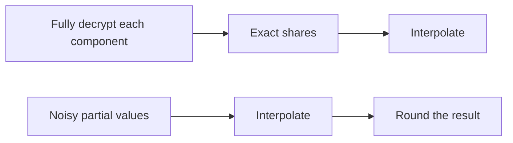
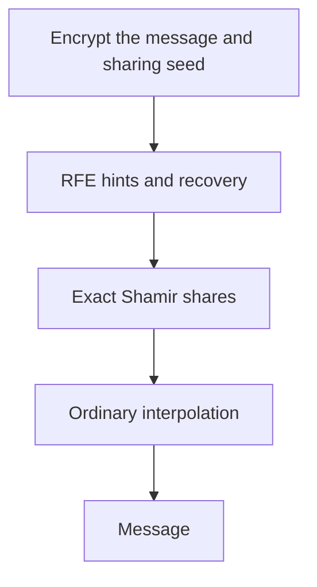

Shamir reconstruction looks reassuringly simple:

$$
\mu=\sum_{i\in S}\omega_{i,S}\sigma_i.
$$

Collect enough shares, calculate the weights, and add. In the [secret-sharing post](), every value in that equation was exact.

The [LWE post]() introduced a different situation. A decryption calculation can leave a message encoding plus a small error, which we remove by rounding.

It is tempting to put these two ideas together: let each user provide a noisy value, then run the usual reconstruction. Surely a few small errors should still be small?

The weights are where this gets uncomfortable. A weight that is perfectly valid in a finite field can be very large when it acts on a small integer error.

## First, which construction are we talking about?

There is an easy threshold-encryption baseline that does **not** have this problem. The sender Shamir-shares a message and encrypts one share under each user's ordinary public key. Each user fully decrypts its ciphertext component, obtaining an exact share. The combiner then interpolates those shares.

An underlying encryption scheme may use LWE internally. As long as each local decryption succeeds, its noise has already been removed before Shamir reconstruction begins.

The difficulty in this post concerns a different template: a more compact construction where the values combined by interpolation are still noisy. The goal is to avoid sending $N$ separate ciphertexts, but we now have to account for the interaction between reconstruction and lattice noise. Champion, Wu, and Yamada discuss this obstacle in their silent threshold encryption paper.[^cwy]

So we should keep these two orders separate:

The second order needs an extra correctness argument.

## Interpolation combines the errors too

Write a noisy value as

$$
\widetilde\sigma_i=\sigma_i+e_i\pmod p.
$$

Here $p$ is the sharing-field modulus. For the small decoding example below, we deliberately set it equal to the LWE modulus $q$; that equality is not a general requirement for threshold encryption.

Reconstruction gives

$$
\begin{aligned}
\sum_{i\in S}\omega_{i,S}\widetilde\sigma_i
&=\sum_{i\in S}\omega_{i,S}\sigma_i
  +\sum_{i\in S}\omega_{i,S}e_i\\
&=\mu+\sum_{i\in S}\omega_{i,S}e_i
\pmod p.
\end{aligned}
$$

The first sum does exactly what we want. The second is the error we still need to tolerate.

Take integer representatives $\bar\omega_{i,S}$ of the field weights. If every $|e_i|\leq B$, an integer lift of the accumulated error satisfies

$$
\left|\sum_{i\in S}\bar\omega_{i,S}e_i\right|
\leq B\sum_{i\in S}|\bar\omega_{i,S}|.
$$

Centered representatives give us small representatives of each residue, but even those can be close to $p/2$. A finite field guarantees exact algebraic identities. It does not guarantee that multiplying by a field element preserves a small decoding error.

## An error of one can flip the result

Let us use a $2$-out-of-$3$ sharing over $\mathbb F_{101}$. We encode bit $1$ as

$$
\mu=\Delta=\lfloor101/2\rfloor=50.
$$

For a hand calculation, fix the sharing polynomial

$$
P(X)=50+4X\pmod{101}.
$$

In actual Shamir sharing, the coefficient is sampled randomly. We fixed it here so that the whole example fits on the page.

Choose users at evaluation points $1$ and $3$. Their exact shares are

$$
\sigma_1=54,\qquad \sigma_3=62.
$$

The interpolation weights at zero are

$$
\omega_{1,S}=\frac{-3}{1-3}=\frac32,
\qquad
\omega_{3,S}=\frac{-1}{3-1}=-\frac12.
$$

These fractions mean **field division**. Since $2^{-1}=51\pmod{101}$,

$$
\omega_{1,S}=52,\qquad \omega_{3,S}=50.
$$

Check the exact reconstruction:

$$
52\cdot54+50\cdot62
=5908
\equiv50\pmod{101}.
$$

Everything is fine so far. Now add just $+1$ to the first share:

$$
\widetilde\sigma_1=55,\qquad
\widetilde\sigma_3=62.
$$

The same reconstruction gives

$$
52\cdot55+50\cdot62
=5960
\equiv1\pmod{101}.
$$

Our decoder sees $1$, which is near the encoding of bit $0$. The original bit was $1$.

| Values given to the combiner | Reconstructed residue | Nearest encoding centre |
|---|---:|---|
| Exact shares $(54,62)$ | $50$ | $50$: bit $1$ |
| Noisy values $(55,62)$ | $1$ | $0$: bit $0$ |

The accumulated error was

$$
E=52\cdot1+50\cdot0
\equiv-49\pmod{101}.
$$

An input error of $1$ became an error of magnitude $49$ in the centered representation. This is an example of a correctness failure in the noisy-value template, not an attack on Shamir's perfect privacy or on a complete threshold-encryption scheme.

### But three halves is a small number

Over the rationals, yes. Over $\mathbb F_{101}$, dividing by two means multiplying by $51$. There is no operation that takes a small integer error of $1$ and turns it into an ordinary real error of $1/2$ while preserving this field calculation.

The choice of reconstruction set matters too. Users at $1$ and $2$ have weights $2$ and $-1$, which are much friendlier. But a threshold scheme must handle every authorized set covered by its correctness definition. Finding one convenient set does not settle the problem.

## First idea: make the reconstruction weights binary

Suppose we write a field coefficient in binary:

$$
\omega_i=\sum_{j=0}^{w-1}b_{i,j}2^j,
\qquad b_{i,j}\in\{0,1\},
\qquad w=\lceil\log_2 p\rceil.
$$

Instead of giving party $i$ one field element $\sigma_i$, give it the vector

$$
(\sigma_i,2\sigma_i,4\sigma_i,\ldots,2^{w-1}\sigma_i).
$$

We can now reconstruct by selecting components with coefficients zero or one. For example, $52=4+16+32$, so the contribution $52\sigma_i$ becomes a sum of three stored components.

This transformation is often called bit decomposition in the binary-reconstruction setting. It expands shares into multiples; it does **not** mean handing out the individual bits of the share value.[^bcm]

There are two catches.

First, if we merely expand an already noisy value, its components contain $e_i,2e_i,4e_i,\ldots$. Selecting them reproduces the original amplified noise. Small reconstruction weights help only when the surrounding cryptographic construction supplies components with suitably controlled errors.

Second, the expanded share coordinates are dependent. If the original share-generating row is $m_i$, its expanded rows are

$$
m_i,\;2m_i,\;4m_i,\;\ldots.
$$

They are scalar multiples of one row. Even one party with several coordinates does not have a block of independent rows.

This does not destroy ordinary secret-sharing privacy: all of those coordinates are computable from the original share. It does violate the stronger requirement that an unauthorized coalition's expanded share coordinates be jointly uniform over the full product space. For a linear sharing map, that uniformity requires full row rank of the corresponding map from sharing randomness to those coordinates. Certain lattice constructions need this additional property.[^bcm]

So the question is more demanding than "can we reconstruct with bits?" We need short shares, controlled noise, and the particular distributional properties required by the construction.

## Second idea: clear the denominators

Our two rational weights were $3/2$ and $-1/2$. Multiplying by $D=2$ gives integer weights $3$ and $-1$:

$$
3\sigma_1-\sigma_3=2\mu\pmod p.
$$

This removes field division from the weighted sum, but now we reconstruct a **scaled** secret. If we immediately multiply the noisy result by $2^{-1}\pmod{101}$, we can reintroduce the same amplification. A useful construction has to account for the scaling in its encoding, decoding, and noise analysis.

For general sets, we also need a denominator that works across the supported reconstruction sets. With evaluation points $1,\ldots,N$, the integer choice

$$
D=(N!)^2
$$

clears all the rational Lagrange denominators. Each denominator is a product of distinct positive differences and distinct negative differences in magnitude; each part divides $(N-1)!$, so the displayed choice is sufficient.

It is a generous choice, not necessarily the smallest one. Its bit length grows as $\Theta(N\log N)$. After scaling, we must track both the integer weights $D\omega_{i,S}$ and the error they multiply. Reducing those weights modulo $q$ before measuring them would hide the integer growth we are trying to understand.

The small example makes denominator clearing look cheap. Across many users and reconstruction sets, a universal scaling factor can become expensive. That observation concerns this approach; it is not a proof that every scaled-sharing construction must pay the same cost.

## Recover a clean share before interpolating

There is another way to approach the problem. Instead of asking Shamir interpolation to tolerate lattice noise, use a cryptographic layer that removes the noise before it returns the share.

This is the role of registered functional encryption in the construction motivating these notes. Fix the number of users and threshold. The registered function for user $i$ computes

$$
f_i(\mu,r)=\operatorname{Share}(i,\mu;r),
$$

where $r$ is fresh sharing randomness chosen by the sender. Encrypt $(\mu,r)$ once under the aggregated RFE public key. Each user produces a hint, and the RFE recovery procedure obtains its function output. The combiner then interpolates the recovered shares.

The lattice layer still has to control its own noise. The difference is where that responsibility ends: once RFE correctly recovers a share, the final interpolation is exact. There is no leftover LWE error for its Lagrange weights to amplify.

For a $T$-out-of-$N$ policy, the user-collusion bound is set to $Q=T-1$. A coalition below the threshold may learn its permitted share outputs without learning the message. Proving this composition requires the appropriate RFE security definition as well as sharing privacy; the diagram alone is not a security proof.[^cwy]

The paper generates sharing randomness from a short pseudorandom seed. That changes the sharing guarantee from perfect privacy to computational privacy, while keeping the encrypted input short.

Here the sharing field can be different from the lattice modulus. The share is encoded as the output of a function, rather than treated as a noisy residue that must be interpolated inside the LWE calculation.

## What I would keep from this example

The awkward part is not that Shamir interpolation has stopped working. It works exactly over its field. The trouble appears when the values supplied to it are still noisy, and we expect the reconstructed result to stay close to a decoding centre.

Three questions help when reading a proposed construction:

1. **What reaches the combiner?** Exact shares, noisy values, or encrypted values?
2. **What multiplies the noise?** Which integer representatives and reconstruction weights enter the bound?
3. **What else does the proof need?** Ordinary share privacy may be insufficient if it also requires uniform unauthorized share coordinates.

The [FE introduction]() explains the idea of giving users access to function outputs. The next step for this series is to examine its registered interface and see how share-generating functions fit into a complete silent threshold encryption scheme.

## References

[^cwy]: Jeffrey Champion, David J. Wu, and Shota Yamada, *Silent Threshold Encryption from Lattices*, 2026. [IACR ePrint 2026/1716](https://eprint.iacr.org/2026/1716). Section 1.2 discusses the noisy-sharing obstacle and the RFE approach; Construction 4.7 gives the compiler using computational secret sharing.

[^bcm]: Marshall Ball, Alper Cakan, and Tal Malkin, *Linear Threshold Secret-Sharing with Binary Reconstruction*, 2021. [ECCC TR21-050](https://eccc.weizmann.ac.il/report/2021/050/). Discusses binary reconstruction, the expansion of Shamir shares, and the additional uniformity requirement for unauthorized shares.
